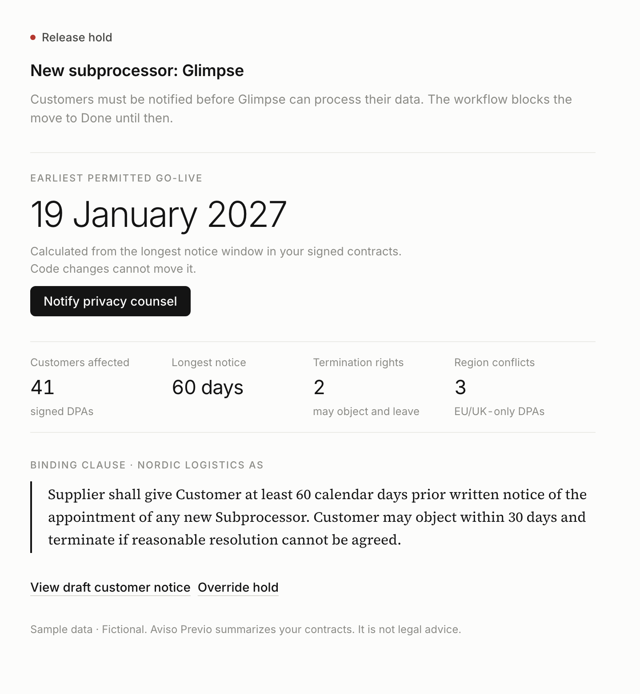
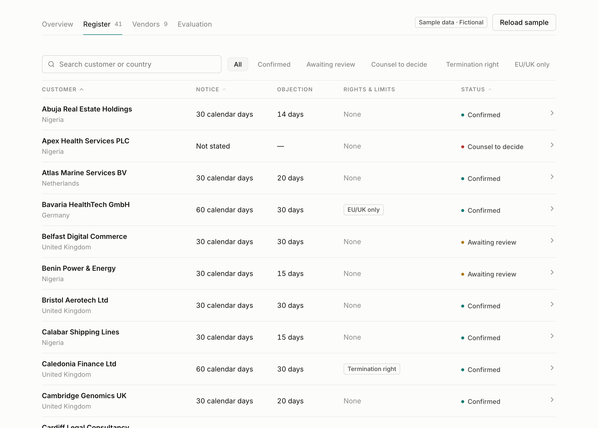
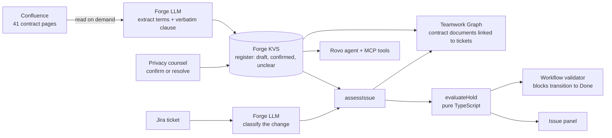

<div align="center">


# Aviso Previo

**A Jira release hold that knows what your customer contracts promise about new subprocessors.**

[Install on your site](https://developer.atlassian.com/console/install/2bd1fd88-a709-4b4c-bf65-fcdac4a24bf8?signature=AYABeLUHU4ahZoGHIOJ0r0vjh50AAAADAAdhd3Mta21zAEthcm46YXdzOmttczp1cy13ZXN0LTI6NzA5NTg3ODM1MjQzOmtleS83MDVlZDY3MC1mNTdjLTQxYjUtOWY5Yi1lM2YyZGNjMTQ2ZTcAuAECAQB4CxqLTo9l4lqXuFjNim1xJM%2Bp%2F3TVP9xHS2BrU5DRRucBjEbcYr6NAMgXvnMTKf%2BjxAAAAH4wfAYJKoZIhvcNAQcGoG8wbQIBADBoBgkqhkiG9w0BBwEwHgYJYIZIAWUDBAEuMBEEDG6mCC1KXa2Cjzn4jwIBEIA7wqYN%2FtV7KPnoNrRdx06LX5zzlqPUXoJfNXyhY72HMk6Pv2eaMoMbJXn34gngnF6%2B%2FOidetYd3XTsIKoAB2F3cy1rbXMAS2Fybjphd3M6a21zOmV1LXdlc3QtMTo3MDk1ODc4MzUyNDM6a2V5LzQ2MzBjZTZiLTAwYzMtNGRlMi04NzdiLTYyN2UyMDYwZTVjYwC4AQICAHi9bVMAkme4qVQX1fQHo6ePw3H40A7cGfz7yrmSfBWMXgGJJ2SbwZVcuscjb58ucVVxAAAAfjB8BgkqhkiG9w0BBwagbzBtAgEAMGgGCSqGSIb3DQEHATAeBglghkgBZQMEAS4wEQQMiqQfn2V3HIzGV58oAgEQgDt9PjE%2FTZVF78j1YdrT%2BEJV26zcpfqejZwCyZngk5vUmOVYXRCp1TlIUvPtKAfm9YHFLxi%2FZ6E%2FBBMfTAAHYXdzLWttcwBLYXJuOmF3czprbXM6dXMtZWFzdC0xOjcwOTU4NzgzNTI0MzprZXkvNmMxMjBiYTAtNGNkNS00OTg1LWI4MmUtNDBhMDQ5NTJjYzU3ALgBAgIAeDYASx0XCjkny4iLV6vz%2BKtEGSGT6kdt0QRpkn6D%2FlVEAYgk8cTtdUagw1Ky3V4vtNEAAAB%2BMHwGCSqGSIb3DQEHBqBvMG0CAQAwaAYJKoZIhvcNAQcBMB4GCWCGSAFlAwQBLjARBAyJv1%2FH72R2PeeZgRkCARCAO53Ri2b0kpeU2KgE0Wxg7CtJnlEsfuPuHLAUec0tBnxsIL9VKc6tcproKa6NlC3FAZktoPWKaWU07RUIAgAAAAAMAAAQAAAAAAAAAAAAAAAAAAwyfomJjVkLUPbxoD%2B%2BDUb%2F%2F%2F%2F%2FAAAAAQAAAAAAAAAAAAAAAQAAADLBjgKUUpK0nOlzuLI49e432DE7NxlCo7w6Gleyo6wxyeI5SAK9YSShv1eKXMk1g%2Be8HgqjeeiMC6h4QrdEqwxW278%3D&product=confluence&product=jira) · [Walkthrough](#try-it) · [How it works](#how-it-works) · [What is real, and what is not](#what-is-real-and-what-is-not) · [Docs](docs/)

      

</div>

<!-- TODO before submitting: add the public YouTube demo link to the row above. -->

**What it is.** Aviso Previo is a Forge app for the people who sign data processing agreements (DPAs) and the engineers who ship the code those agreements cover. When a Jira ticket brings in a new third-party processor, or moves an existing one to another region, the issue panel shows which customer contracts apply, the longest notice period, and the earliest date the change may go live. A workflow validator blocks the move to Done until then. Privacy counsel get an admin workspace to review every contract term next to the clause it came from.

**The problem.** B2B SaaS companies promise enterprise customers 30 to 60 days of written notice before they add a subprocessor or move data out of a region. Engineering finds out about a vendor in a ticket on Monday and ships on Friday. Legal finds out afterwards. One missed notice can be a breach of dozens of contracts, and a few customers can terminate over it. The knowledge needed to prevent this exists, but it sits in contracts in one tool and in tickets in another.

**The idea: a model reads, code decides.** The model has two jobs. It reads a ticket and says what kind of change it is: new vendor, region change, synthetic data only, routine, or unrelated ([`ticketClassifier.ts#L100`](src/classification/ticketClassifier.ts#L83)). And it reads a contract's Confluence page and quotes the subprocessor clause with its terms ([`extractor.ts#L53`](src/extraction/extractor.ts#L48)). Everything with legal weight is plain TypeScript:

- The notice date is arithmetic over the contract terms, with calendar and business days handled separately ([`dateCalculator.ts`](src/engine/dateCalculator.ts)).
- Whether a hold applies is one pure function, [`evaluateHold`](src/engine/holdPolicy.ts). Only terms that counsel has **confirmed** count toward the date. If nothing is confirmed, the release is blocked, never allowed.
- The workflow validator and the issue panel both call the same [`assessIssue`](src/assessment/assessIssue.ts), so they cannot disagree. There are no ticket-specific branches.
- A vague clause such as "a reasonable period" is never turned into a number: the prompt forces it to `unclear`, and only a person can resolve it ([`extractor.ts#L30`](src/extraction/extractor.ts#L25)).
- A clause the model quotes must be found word for word in the contract page, or it is rejected ([`text.ts`](src/extraction/text.ts)).
- If the model call fails, the classifier falls back to cautious rules instead of failing open ([`ticketClassifier.ts`](src/classification/ticketClassifier.ts)).

<p align="center">
  
  &nbsp;
  
</p>

**Try it.** [Install Aviso Previo](https://developer.atlassian.com/console/install/2bd1fd88-a709-4b4c-bf65-fcdac4a24bf8?signature=AYABeLUHU4ahZoGHIOJ0r0vjh50AAAADAAdhd3Mta21zAEthcm46YXdzOmttczp1cy13ZXN0LTI6NzA5NTg3ODM1MjQzOmtleS83MDVlZDY3MC1mNTdjLTQxYjUtOWY5Yi1lM2YyZGNjMTQ2ZTcAuAECAQB4CxqLTo9l4lqXuFjNim1xJM%2Bp%2F3TVP9xHS2BrU5DRRucBjEbcYr6NAMgXvnMTKf%2BjxAAAAH4wfAYJKoZIhvcNAQcGoG8wbQIBADBoBgkqhkiG9w0BBwEwHgYJYIZIAWUDBAEuMBEEDG6mCC1KXa2Cjzn4jwIBEIA7wqYN%2FtV7KPnoNrRdx06LX5zzlqPUXoJfNXyhY72HMk6Pv2eaMoMbJXn34gngnF6%2B%2FOidetYd3XTsIKoAB2F3cy1rbXMAS2Fybjphd3M6a21zOmV1LXdlc3QtMTo3MDk1ODc4MzUyNDM6a2V5LzQ2MzBjZTZiLTAwYzMtNGRlMi04NzdiLTYyN2UyMDYwZTVjYwC4AQICAHi9bVMAkme4qVQX1fQHo6ePw3H40A7cGfz7yrmSfBWMXgGJJ2SbwZVcuscjb58ucVVxAAAAfjB8BgkqhkiG9w0BBwagbzBtAgEAMGgGCSqGSIb3DQEHATAeBglghkgBZQMEAS4wEQQMiqQfn2V3HIzGV58oAgEQgDt9PjE%2FTZVF78j1YdrT%2BEJV26zcpfqejZwCyZngk5vUmOVYXRCp1TlIUvPtKAfm9YHFLxi%2FZ6E%2FBBMfTAAHYXdzLWttcwBLYXJuOmF3czprbXM6dXMtZWFzdC0xOjcwOTU4NzgzNTI0MzprZXkvNmMxMjBiYTAtNGNkNS00OTg1LWI4MmUtNDBhMDQ5NTJjYzU3ALgBAgIAeDYASx0XCjkny4iLV6vz%2BKtEGSGT6kdt0QRpkn6D%2FlVEAYgk8cTtdUagw1Ky3V4vtNEAAAB%2BMHwGCSqGSIb3DQEHBqBvMG0CAQAwaAYJKoZIhvcNAQcBMB4GCWCGSAFlAwQBLjARBAyJv1%2FH72R2PeeZgRkCARCAO53Ri2b0kpeU2KgE0Wxg7CtJnlEsfuPuHLAUec0tBnxsIL9VKc6tcproKa6NlC3FAZktoPWKaWU07RUIAgAAAAAMAAAQAAAAAAAAAAAAAAAAAAwyfomJjVkLUPbxoD%2B%2BDUb%2F%2F%2F%2F%2FAAAAAQAAAAAAAAAAAAAAAQAAADLBjgKUUpK0nOlzuLI49e432DE7NxlCo7w6Gleyo6wxyeI5SAK9YSShv1eKXMk1g%2Be8HgqjeeiMC6h4QrdEqwxW278%3D&product=confluence&product=jira) on a Jira and Confluence site where you are an admin, then open **Aviso Previo Admin** (Jira settings, Apps).

1. **Load the sample.** Click **Load sample data**. It runs in steps with progress: it loads the fictional company Ayo Payroll into the register (41 customer DPAs with hand-labelled terms, 40 already confirmed by "counsel" and one ambiguous), creates a Jira project `ENG` with four tickets, and writes all 41 contracts as Confluence pages in a `CONTRACTS` space.
2. Open **Register** and click **Apex Health Services PLC**. Its clause says "a reasonable period", so it shows **Counsel to decide** and no number is guessed. Click **Read with Claude**: the model reads the Confluence page and should agree. Enter a notice period and press **Resolve and confirm** to decide it as counsel.
3. Open **Nordic Logistics AS** and click **Read with Claude**. The reading is compared with the register field by field, and the quoted clause is checked against the page.
4. Open **Evaluation** and click **Run evaluation**. The model reads all 41 contracts from Confluence and each answer is scored against its label. This makes 41 Forge LLM calls.
5. **Switch the release hold on (one time, about a minute).** Jira only runs a workflow validator once an admin adds it to a transition, so installing the app is not enough. Open the **Engineering** space, then **Space settings**, then **Workflows**. Edit the workflow, click the transition into **Done**, open the **Validate details** tab, choose **Add rule**, pick **Aviso Previo Subprocessor Hold**, then **Update** and **Publish** the workflow. Repeat for any other transition that deploys, such as *Deployed* or *Production*.
6. Open the ticket *Add session replay to payslip screen using Glimpse*. The first view classifies it and starts the notice clock. The panel shows the release hold, the earliest go-live (60 days after the first assessment), the confirmed contracts it applies to, and the binding clause. The first view classifies it, and **Re-check this ticket** reads it again if its text changes. Try to move it to **Done**: the validator refuses and says why.
7. Click **View draft customer notice**, then **Notify privacy counsel**. A Jira request is created in project `PRIV` if it exists, otherwise in the ticket's own project, and its real key is shown.
8. Open *Upgrade ErrorSentry SDK to v8*. The vendor is approved, so the panel says **No action needed** and the transition goes through. Then open *Evaluate Glimpse in sandbox with synthetic data only*: the panel asks someone to **Confirm synthetic data only**, and moving it to Done is blocked until they do, because a wrongly "synthetic" ticket is how real customer data would slip through.

9. **Teamwork Graph (optional, admin, one time).** Open admin.atlassian.com, then **Connectors**, find **Aviso Previo Contracts** and click **Add connector**. The contracts are added to the graph and linked to the tickets you have viewed. The admin overview shows the last sync, and **Sync now** repeats it.
10. **Rovo agent.** In **Jira**, click **Ask Rovo**, pick the **Aviso Previo** agent and ask *What would adding Glimpse commit us to?* It answers from the register through its tools, never from memory.

**Atlassian, concretely.**
- **Jira workflow validator:** blocks release-type transitions on a held ticket and says why, with the date ([`validator/index.ts`](src/validator/index.ts)). A counsel override with a recorded reason lifts the hold. If a ticket cannot be assessed, the transition is blocked.
- **Jira issue panel, glance and context:** one Custom UI bundle shows the assessment where the engineer already works ([`admin-ui/panel/`](admin-ui/panel/)).
- **Confluence:** all 41 sample contracts are written as pages (idempotently, in batches) and read back by the extractor through the Confluence v2 API ([`confluence/pages.ts`](src/confluence/pages.ts), [`seedEngine.ts`](src/seed/seedEngine.ts)).
- **Rovo agent and MCP tools:** an Aviso Previo agent, and the same three tools over MCP, let people and other agents ask about a vendor, quote a customer's clause, or open a privacy request ([`manifest.yml`](manifest.yml), [`rovo/actions.ts`](src/rovo/actions.ts)).
- **Teamwork Graph:** each contract is ingested as a document and linked to the Jira tickets whose release hold it binds ([`graph/contractGraph.ts`](src/graph/contractGraph.ts)).
- **Forge KVS and Forge LLM:** the register and ticket decisions live in `@forge/kvs`; classification and extraction use `@forge/llm`, so contract and ticket text stay inside Atlassian.

**Honest limits.**
- **The sample register is seeded with hand-labelled terms.** The model reads a contract from Confluence on demand ("Read with Claude") and in the Evaluation tab. It does not yet watch Confluence and ingest new or edited pages by itself.
- **The notice clock starts when a ticket is first assessed,** not when the customer notice is actually sent.
- **One live evaluation run is recorded below.** The tests use a fake model, and the fallback rules score 28/30 on the labelled tickets after being tuned while looking at that set, so treat that number as optimistic.
- **The vendor's hosting region comes from the ticket text.** If the ticket does not say, the region is treated as outside the EU/UK.
- **The workflow validator may call the model.** The first assessment of an unseen ticket reads it from Jira and classifies it; later checks use the stored decision.
- **Rovo and MCP tools are tested directly,** not through a live Rovo or external MCP client. The Rovo agent is deployed, but its answers have not been evaluated.
- **The register is authoritative in the Jira install.** Forge storage is per product install, so a shared read-only copy is published as a Confluence page ("Aviso Previo register (managed by the app, do not edit)") and the Rovo agent reads it when asked from Confluence. Opening a privacy request needs Jira's ticket records, so from Confluence the agent points you to Jira. Two copies of the agent appear (one per install); both answer.
- **The Teamwork Graph sync is tested against a fake graph client.** It only runs after an admin connects the connector, and the shape of what the graph accepts is confirmed by the live **Sync now** result, not by this repo's tests.
- **Sample data only.** Aviso Previo summarizes contracts and is not legal advice.

More in [What is real, and what is not](#what-is-real-and-what-is-not).

## What is in the app

**For privacy counsel (admin page):**

- An overview of counsel review progress, the mix of notice periods, termination rights and EU/UK-only limits, and the contracts that need attention first.
- A searchable, sortable register of all 41 DPAs, filtered by status or by termination right and EU/UK-only.
- A review drawer that puts the terms beside the clause as signed. **Read with Claude** reads the contract's Confluence page and compares field by field; **Use Claude's reading** sends differing terms back to review.
- Ambiguous clauses are marked **Counsel to decide**. Counsel enters the notice period they read and resolves the contract; a button cannot confirm it.
- Single and bulk confirmation, the approved vendor list with hosting location, and a stepped sample-data loader with progress.
- An evaluation that runs the model over every contract and scores it against the labels.

**For engineers (Jira):**

- An issue panel with five states: new subprocessor, region change, synthetic data only (a person must confirm it, and it is recorded who), no action needed, and "contract terms not verified yet".
- The earliest permitted go-live date, the affected customer count, the longest notice, termination rights, region conflicts and the binding clause quote, all from the confirmed register.
- A draft customer notice, a one-click privacy request, and a human override that records who and why.
- A workflow validator that stops a held ticket from reaching Done.

**For agents (Rovo, MCP and the Teamwork Graph):**

- A Rovo agent, **Aviso Previo**, with conversation starters, whose prompt makes it use its tools for every contract fact.
- `check-subprocessor-commitments`, `explain-customer-term` and `open-privacy-notice-request`, each returning the legal disclaimer, also exposed over MCP.
- A Teamwork Graph connector that adds each DPA to the graph as a document and associates it with the Jira tickets it binds, so contracts and work are connected in the graph. An admin status card and a **Sync now** button show the last sync.

<p align="center">
  
</p>

## How Atlassian is used

| Piece | Platform feature | Where |
|---|---|---|
| Release hold | `jira:workflowValidator` | [`src/validator/index.ts`](src/validator/index.ts) |
| One assessment for panel, validator and tools | Forge functions, `@forge/kvs` | [`src/assessment/assessIssue.ts`](src/assessment/assessIssue.ts) |
| Engineer view | `jira:issuePanel`, `jira:issueGlance`, `jira:issueContext`, one Custom UI bundle | [`admin-ui/panel/`](admin-ui/panel/) |
| Counsel workspace | `jira:adminPage`, Custom UI | [`admin-ui/src/`](admin-ui/src/) |
| Ticket understanding | `@forge/llm` (Claude), with a cautious rule fallback | [`src/classification/ticketClassifier.ts`](src/classification/ticketClassifier.ts) |
| Contract extraction | `@forge/llm`, reading the Confluence page; the clause must be found word for word | [`src/extraction/extractor.ts`](src/extraction/extractor.ts) |
| Register and decisions | `@forge/kvs` (`dpa:{id}`, `vendor:{key}`, `decision:{issueKey}`) | [`src/storage/register.ts`](src/storage/register.ts) |
| Contract pages | Confluence REST v2: find the space, create or update pages, read them back | [`src/confluence/pages.ts`](src/confluence/pages.ts) |
| Privacy request | Jira REST: creates a Task in project `PRIV` if it exists, else in the ticket's project | [`src/legal/legalRequest.ts`](src/legal/legalRequest.ts) |
| Agent | `rovo:agent` with three Rovo `action` modules | [`manifest.yml`](manifest.yml), [`src/rovo/actions.ts`](src/rovo/actions.ts) |
| Agent tools over MCP | `rovo:mcp` | [`manifest.yml`](manifest.yml) |
| Contracts and tickets in the graph | `graph:connector`, `@forge/teamwork-graph` (`setObjects`, `atlassian:document`, `issueIdOrKeys` associations) | [`src/graph/contractGraph.ts`](src/graph/contractGraph.ts) |
| Date and hold logic | Plain TypeScript: calendar and business days, fail closed | [`src/engine/`](src/engine/) |

Every manifest module, scope and API signature is logged against the Atlassian docs in [docs/FORGE.md](docs/FORGE.md).

## Full walkthrough

**Judges (no setup):** follow [Try it](#try-it). The most telling checks are step 2 (an ambiguous clause is not guessed) and step 5 (try to move the Glimpse ticket to Done).

**Locally:**

```bash
npm install
npm --prefix admin-ui install
npm run build          # type-checks the functions, builds the admin page and the issue panel
npm test               # 60 tests that run the real modules against fake Jira, Confluence, storage and model
forge lint
```

**Preview the UI without Jira** (local sample data with a mock server, no login):

```bash
cd admin-ui
npm run dev            # admin page at http://localhost:5173
npm run dev:panel      # issue panel; add #new, #location, #quiet, #synthetic, #elapsed or #unverified to the URL
```

The local preview answers from an in-memory mock, so its numbers are not results. The evaluation tab only gives real figures inside Jira.

**Deploy and install:**

```bash
npm run build
forge deploy -e development
forge install --site <your-site>.atlassian.net --product jira
forge install --site <your-site>.atlassian.net --product confluence
```

Custom UI is served from `admin-ui/dist` and `admin-ui/dist-panel`, so run `npm run build` before every `forge deploy`.

**Cost.** Each "Read with Claude" is one Forge LLM call, the evaluation is 41, and each new ticket is classified with one. See [docs/COSTS.md](docs/COSTS.md).

## Use it from an AI agent

The **Aviso Previo** Rovo agent uses three tools, and the same tools are exposed through `rovo:mcp`, each backed by a Rovo `action`. They read the same register the app uses, count only confirmed terms, and always return the disclaimer.

| Tool | Input | Returns |
|---|---|---|
| `check-subprocessor-commitments` | `vendor`, optional `hostingLocation` | Whether the vendor is approved, how many confirmed contracts apply, longest notice, termination rights, region conflicts, a what-if earliest go-live from today |
| `explain-customer-term` | `customerName` (name or id such as `CUST-001`) | The verbatim clause, notice days and unit, objection window, remedy, and whether counsel has confirmed it |
| `open-privacy-notice-request` | `issueKey` | A real Jira privacy request (or the one already linked) and a draft customer notice |

An empty register is an error, not an invented answer, and a failed Jira call is an error, not a made-up key.

## How it works



**The date** is computed in one pure function. The clock starts the first time a ticket is assessed and is stored with the decision, so it does not slide forward as time passes. The hold runs to the end of the longest notice period among the contracts that apply.

```
for each applicable DPA (confirmed terms only):
    if unit == business_days:  unlock = addBusinessDays(start, days)   # weekends skipped
    else:                      unlock = addCalendarDays(start, days)
earliestGoLive = max(unlock)           # the longest notice wins
hold is active while now < earliestGoLive

new vendor  -> every confirmed contract applies
region move -> only EU/UK-restricted contracts apply (unknown region = outside EU/UK)
nothing confirmed -> blocked (fails closed)
```

**Design rules**

- The model never does arithmetic and never makes a legal decision. It labels a ticket, or it quotes and reads a clause.
- A failed or malformed model reply degrades to rules or to `unclear`, never to "allowed".
- Every extracted term keeps its verbatim clause, and a quote that is not in the contract is rejected.
- Counsel confirmation gates what counts. Counsel can also override a hold, and the override records who and why.
- Numbers on screen come from the register at the moment you look, not from a stored copy.
- The admin page and the issue panel follow Jira's light and dark mode.

```
src/
  index.ts                  Exports the resolver, validator and Rovo actions
  resolvers/index.ts        Everything the UI calls: assessment, register, confirm, resolve, extract, evaluate, seed steps
  assessment/               assessIssue: the one place a ticket is assessed
  engine/                   dateCalculator (dates) and holdPolicy (does a hold apply?)
  validator/                Jira workflow validator
  classification/           Ticket classifier (Forge LLM with a cautious rule fallback)
  extraction/               Contract extractor, verbatim-clause check, HTML to text
  evaluation/               Scores a model reading against a label
  confluence/               Find or create the space, upsert pages, read a page
  storage/                  Register and vendor reads from KVS
  legal/                    Draft customer notice and the Jira privacy request
  rovo/                     MCP and Rovo actions
  graph/                    Teamwork Graph connector: contracts as documents, linked to tickets
  seed/, data/              The fictional Ayo Payroll sample: 41 DPAs, 9 vendors, planted tickets
admin-ui/
  src/                      Admin page (Custom UI, React + Vite)
  panel/                    Issue panel, glance and context (Custom UI)
assets/                     Logo, icons, cover and BRAND.md
scripts/test/               The tests, with fake Jira, Confluence, storage and model
docs/                       Forge reference, storage decision, costs, Devpost and video notes
```

## Built for the Codegeist criteria

**Category:** Apps for Business Teams (legal and privacy). **Bonus prizes aimed at:** Best Agents (a `rovo:agent` with three reusable `action` modules), Best app with Atlassian MCP (`rovo:mcp`, three tools), and Best apps with Teamwork Graph integration (a `graph:connector` that links contracts to tickets). Marketplace is not entered.

| Criterion | Where to look |
|---|---|
| Technological implementation | A workflow validator and issue panel driven by one data-driven assessment, a deterministic date engine, model-based ticket classification and contract extraction with a verbatim-clause check, an evaluation that runs the model over 41 Confluence pages, a counsel review and resolution flow, a Rovo agent with three tools also exposed over MCP, a Teamwork Graph connector, real Confluence and Jira reads and writes, and 60 tests that run the actual modules. The limits are listed above. |
| Design | One minimal system across admin and issue panel: [assets/BRAND.md](assets/BRAND.md). Responsive down to the Jira sidebar, light and dark. |
| Potential impact | Subprocessor-notice breaches are a real, specific contractual risk for any SaaS company with enterprise customers. The audience is privacy counsel, DPOs and the engineers who ship. |
| Innovation | Contract commitments checked at the moment a ticket changes status, instead of in a spreadsheet after the fact, with a model that is kept away from the decision and made to prove its quotes. |
| Presentation | The demo path is [Try it](#try-it): load data, resolve an ambiguous clause, read a contract with Claude, try to ship the Glimpse ticket, see it blocked. |

## What is real, and what is not

**Built and tested** (`npm test`, 60 tests with the real modules and a fake Jira, Confluence, storage and model):

- The date engine: calendar days, business days that skip weekends, UTC-safe, the longest notice winning (12 tests, with the hold policy).
- The hold policy: only confirmed terms count, it fails closed when nothing is confirmed, region changes only touch restricted contracts, an unknown region counts as outside, and the clock does not slide.
- The workflow validator on arbitrary ticket keys: it blocks with numbers from the register, allows moves before release, honours a counsel override, ends when the window passes, and blocks when the ticket cannot be read (10 tests).
- The classifier: model reply parsing, the fallback when the model fails, and the fallback rules on 30 labelled tickets (3 tests).
- The extractor: verbatim-clause verification, rejection of an invented clause, failures reported as errors, and the scoring of a reading against a label (9 tests).
- The Rovo tools: new, approved and moved vendors, the empty-register error, ambiguous clauses, and privacy requests created for real, idempotent, and never faked (12 tests).
- The Confluence seeding: one page per contract in batches, safe to repeat, and readable back as text (4 tests).
- The Teamwork Graph sync: nothing happens until connected, contracts become workspace-visible documents, tickets are linked only to the contracts their hold binds, and rejections and failures are recorded (9 tests).

**Built, not covered by automated tests:**

- The Custom UI admin page and issue panel (checked by hand and in a browser with a mock server).
- The calls to the real Jira, Confluence and Forge LLM APIs. The tests replace them with fakes; the app is deployed to a development site.
- The live model's accuracy beyond the single recorded run above, and live-model ticket classification, which is not scored.

**Not built, or not what it might sound like:**

- **Automatic ingestion.** The register is seeded with labelled terms. The model re-reads a contract on demand and in the evaluation, but nothing watches Confluence for new or edited contracts.
- **The sample "counsel" confirmations.** 40 of 41 contracts are pre-confirmed in the sample so the hold works immediately.
- **Notice sent versus assessed.** The clock starts at first assessment, not when the notice goes out.
- **Hosting region.** It is read from the ticket text, with unknown treated as outside the EU/UK.
- **Live-model ticket classification accuracy** is not measured; only contract extraction has a recorded run.
- **Agent quality.** The Rovo agent is deployed with a bounded prompt, but there is no recorded evaluation of its answers.
- **A live graph sync result.** It appears on the admin page once an admin connects the connector.
- **Marketplace.** The app is not listed.

## Live extraction results

The **Evaluation** tab has Forge LLM (Claude) read all 41 contracts from their Confluence pages and scores every answer against the label each sample contract was written with. A confident wrong answer counts as a failure, and an ambiguous clause only counts as right if it is flagged. Two runs on a development site, 20 November 2026:

| Check | Run 1 | Run 2 (after fixing the sample text) |
|---|---|---|
| Quoted clause found word for word | 41/41 | 41/41 |
| Termination rights found | 2/2 | 2/2 |
| EU/UK-only limits found | 3/3 | 3/3 |
| Ambiguous clause ("a reasonable period") flagged unclear | 1/1 | 1/1 |
| Notice period matches the label | 29/41 | **41/41** |
| Calendar vs. business days matches the label | 29/41 | **41/41** |
| Wrong answers (certain, and wrong) | **0** | **0** |
| Declined to guess | 12 | 0 |

**What happened between the runs.** In run 1, twelve contracts came back as unclear. Their clauses gave a number of days but never said calendar or business days (for example "thirty (30) days prior electronic notice"), while the labels assumed calendar days. The model was right to decline: the sample text was underspecified. I changed those twelve clauses, and one more with the same wording, to say "calendar days", and ran it again. I did not change the labels or the prompt.

**How to read this.** Run 2 is a clean result, but the set is 41 contracts the author wrote, and the data was corrected after the first run. It shows the behaviour (it quotes the clause, it flags what it cannot decide, and no wrong number reached the register), not a general accuracy figure. One more detail: Belfast Digital Commerce had the same unit-less wording as the twelve but was read correctly in run 1, so the model is not perfectly consistent on an ambiguous clause.

## Tests and verification

```bash
npm test
```

| File | What it checks |
|---|---|
| [`engine.test.ts`](scripts/test/engine.test.ts) | Dates, weekends, timezone independence, region parsing, and the hold policy |
| [`validator.test.ts`](scripts/test/validator.test.ts) | The real workflow validator on any ticket key, override, elapsed window, fail closed |
| [`classifier.test.ts`](scripts/test/classifier.test.ts) | Model parsing, the rule fallback, and its score on `src/data/ticketTestSet.json` |
| [`extraction.test.ts`](scripts/test/extraction.test.ts) | Verbatim-clause checking, invented clauses, errors, and the scoring |
| [`rovo.test.ts`](scripts/test/rovo.test.ts) | The three Rovo tools and the privacy request |
| [`seed.test.ts`](scripts/test/seed.test.ts) | Writing and re-writing the Confluence pages, and reading them back |
| [`graph.test.ts`](scripts/test/graph.test.ts) | The Teamwork Graph sync: documents, permissions, ticket links, rejections |

The tests load [`helpers.ts`](scripts/test/helpers.ts) first, which swaps `@forge/kvs`, `@forge/api`, `@forge/llm` and `@forge/teamwork-graph` for in-memory fakes. The code under test is the real code, unmodified. They do not measure the live model: for that, use the **Evaluation** tab.

Related docs: [docs/FORGE.md](docs/FORGE.md) (every module, scope and API), [docs/STORAGE_DECISION.md](docs/STORAGE_DECISION.md), [docs/COSTS.md](docs/COSTS.md), [docs/DEVPOST.md](docs/DEVPOST.md), [docs/VIDEO_SCRIPT.md](docs/VIDEO_SCRIPT.md).

## License

MIT. Built for Atlassian Codegeist 2026. All customers, contracts and tickets in the sample data are fictional.
