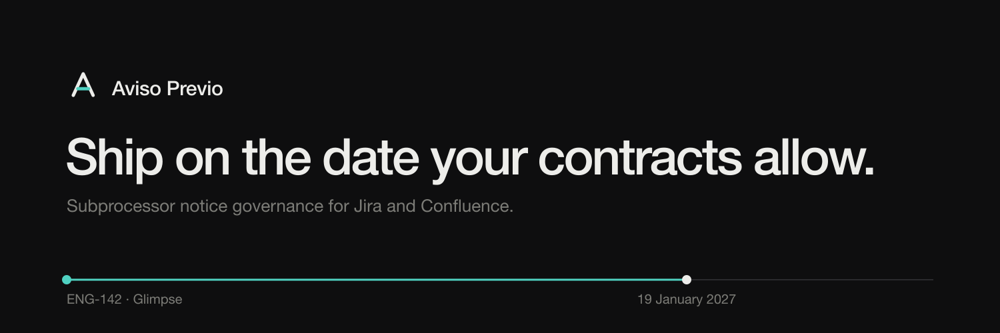
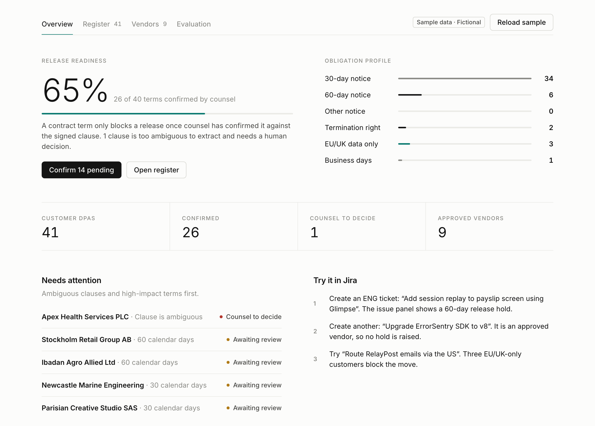
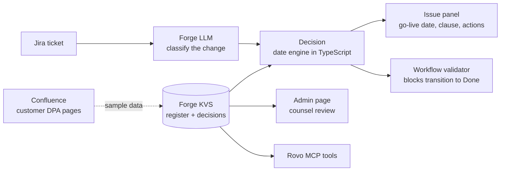

<div align="center">



# Aviso Previo

**A Jira release hold that knows what your customer contracts promise about new subprocessors.**

[Walkthrough](#try-it) · [How it works](#how-it-works) · [What is real, and what is not](#what-is-real-and-what-is-not) · [Docs](docs/)

    

</div>

<!-- TODO before submitting: add the public YouTube demo link and the Forge installation link to the row above and to "Try it". -->

**What it is.** Aviso Previo is a Forge app for the people who sign data processing agreements (DPAs) and the engineers who ship the code those agreements cover. When a Jira ticket brings in a new third-party processor, or moves an existing one to another region, the issue panel shows which customer contracts apply, the longest notice period, and the earliest date the change may go live. A workflow validator blocks the move to Done until then. Privacy counsel get an admin workspace to review every contract term next to the clause it came from.

**The problem.** B2B SaaS companies promise enterprise customers 30 to 60 days of written notice before they add a subprocessor or move data out of a region. Engineering finds out about a vendor in a ticket on Monday and ships on Friday. Legal finds out afterwards. One missed notice can be a breach of dozens of contracts, and a few customers can terminate over it. The knowledge needed to prevent this exists, but it sits in contracts in one tool and in tickets in another.

**The idea: a model reads, code decides.** The model's only job is to read a ticket and say what kind of change it is (new vendor, region change, synthetic data only, routine, unrelated) ([`ticketClassifier.ts#L83`](src/classification/ticketClassifier.ts#L83)). Everything that has legal weight is plain TypeScript: the notice date is arithmetic over the contract terms, with calendar and business days handled separately ([`dateCalculator.ts#L22`](src/engine/dateCalculator.ts#L22), [`#L67`](src/engine/dateCalculator.ts#L67)), and the release hold is a deterministic check in the workflow validator ([`validator/index.ts`](src/validator/index.ts)). A vague clause such as "a reasonable period" is never turned into a number: the extraction prompt forces it to `unclear`, for a person to decide ([`extractor.ts#L25`](src/extraction/extractor.ts#L25)). If the model call fails, the classifier falls back to keyword rules instead of failing open ([`ticketClassifier.ts#L112`](src/classification/ticketClassifier.ts#L112)). Every contract term is stored with the exact clause it came from, so counsel can check the term against the wording.

<p align="center">
  
  &nbsp;
  
</p>

**Try it.** Use the installation link in the Devpost submission, then open the **Aviso Previo Admin** page (Jira settings, Apps).

1. Click **Load sample data**. It creates the fictional company Ayo Payroll: 41 customer DPAs and 9 approved vendors in app storage, a Confluence space `CONTRACTS` with contract pages, and a Jira project `ENG` with four planted tickets.
2. Open the **Register** tab and click **Apex Health Services PLC**. Its clause says "a reasonable period", so it shows **Counsel to decide** and no date is guessed. Open **Nordic Logistics AS** to see 60 calendar days, a termination right and an EU/UK-only limit, with the clause beside the extracted terms.
3. Open the ticket *Add session replay to payslip screen using Glimpse*. The **Aviso Previo** panel shows the release hold, **19 January 2027** as the earliest go-live, 41 affected customers and the binding clause. Try to move the ticket to **Done**: the workflow validator refuses it and says why.
4. Click **View draft customer notice**, then **Notify privacy counsel**. A privacy request is opened.
5. Open *Upgrade ErrorSentry SDK to v8*. The vendor is already approved, so the panel says **No action needed** and the transition goes through.

**Atlassian, concretely.**
- **Jira workflow validator:** blocks transitions on a held ticket and tells the person why, with the date ([`validator/index.ts#L79`](src/validator/index.ts#L79)). A counsel override with a recorded reason lifts the hold ([`#L57`](src/validator/index.ts#L57)).
- **Jira issue panel, glance and context:** one Custom UI bundle shows the assessment where the engineer already works ([`admin-ui/panel/`](admin-ui/panel/)).
- **Confluence:** the sample contracts are written as pages in a `CONTRACTS` space through the Confluence v2 API ([`seedEngine.ts#L161`](src/seed/seedEngine.ts#L161)).
- **Rovo MCP tools:** three tools let an agent ask about a vendor, quote a customer's clause, or open a privacy request ([`manifest.yml`](manifest.yml), [`rovo/actions.ts`](src/rovo/actions.ts)).
- **Forge KVS and Forge LLM:** contract terms and ticket decisions live in `@forge/kvs`; ticket classification uses `@forge/llm`, so contract and ticket text stay inside Atlassian.

**Honest limits.**
- **Contract extraction by the model is written but not wired in.** [`extractDPATerms`](src/extraction/extractor.ts#L48) is never called at runtime. The register is loaded from the seeded sample contracts, which are also written to Confluence, but the app does not yet read Confluence pages back and extract them live.
- **The release hold is partly hardcoded for the demo tickets.** The validator has explicit branches for the Glimpse ticket and one RelayPost ticket, with fixed messages ([`validator/index.ts#L63`](src/validator/index.ts#L63), [`#L104`](src/validator/index.ts#L104)). Other tickets go through the data-driven path, which reads the stored decision.
- **Counsel confirmation does not gate holds yet.** Confirming a term updates the register, but the validator and date engine do not filter on it.
- **The extraction and ticket scores are from rule-based scripts,** not from the Forge LLM, and the admin's "Run evaluation" shows fixed numbers. Details in [Tests](#tests-and-verification).
- **Sample data only.** Everything runs on the fictional Ayo Payroll company. Aviso Previo summarizes contracts and is not legal advice.

More in [What is real, and what is not](#what-is-real-and-what-is-not).

## What is in the app

**For privacy counsel (admin page):**

- An overview of counsel review progress, the mix of notice periods, termination rights and EU/UK-only limits, and the contracts that need attention first.
- A searchable, sortable register of all 41 DPAs, filtered by status or by termination right and EU/UK-only.
- A review drawer that puts the extracted terms beside the clause as signed, with the notice wording highlighted. Ambiguous clauses are marked **Counsel to decide** and cannot be confirmed by a button.
- Single and bulk confirmation, the approved vendor list with hosting location, and a sample-data loader.

**For engineers (Jira):**

- An issue panel with four states: new subprocessor, region change, synthetic data only, and no action needed.
- The earliest permitted go-live date, the affected customer count, the longest notice, termination rights, region conflicts and a binding clause quote.
- A draft customer notice, a one-click privacy request, and a human override that records who and why.
- A workflow validator that stops a held ticket from reaching Done.

**For agents (Rovo and MCP):**

- `check-subprocessor-commitments`, `explain-customer-term` and `open-privacy-notice-request`, each returning the legal disclaimer.

<p align="center">
  
</p>

## How Atlassian is used

| Piece | Platform feature | Where |
|---|---|---|
| Release hold | `jira:workflowValidator` | [`src/validator/index.ts`](src/validator/index.ts) |
| Engineer view | `jira:issuePanel`, `jira:issueGlance`, `jira:issueContext`, one Custom UI bundle | [`admin-ui/panel/`](admin-ui/panel/) |
| Counsel workspace | `jira:adminPage`, Custom UI | [`admin-ui/src/`](admin-ui/src/) |
| Ticket understanding | `@forge/llm` (Claude), with a keyword fallback | [`src/classification/ticketClassifier.ts`](src/classification/ticketClassifier.ts) |
| Contract extraction (not yet live) | `@forge/llm` with a verbatim-clause and `unclear` contract | [`src/extraction/extractor.ts`](src/extraction/extractor.ts) |
| Register and decisions | `@forge/kvs` (`dpa:{id}`, `vendor:{key}`, `decision:{issueKey}`) | [`src/resolvers/index.ts`](src/resolvers/index.ts) |
| Contract pages | Confluence REST v2 | [`src/seed/seedEngine.ts`](src/seed/seedEngine.ts) |
| Privacy request | Jira REST: creates an issue in project `PRIV` if it exists | [`src/legal/legalRequest.ts`](src/legal/legalRequest.ts) |
| Agent tools | `rovo:mcp` and Rovo `action` modules | [`src/rovo/actions.ts`](src/rovo/actions.ts) |
| Date engine | Plain TypeScript: calendar and business days | [`src/engine/dateCalculator.ts`](src/engine/dateCalculator.ts) |

Every manifest module, scope and API signature is logged against the Atlassian docs in [docs/FORGE.md](docs/FORGE.md).

## Full walkthrough

**Judges (no setup):** follow [Try it](#try-it). The most telling check is step 3: try to move the Glimpse ticket to Done.

**Locally:**

```bash
npm install
npm --prefix admin-ui install
npm run build          # type-checks the functions, builds the admin page and the issue panel
npm test               # four scripts: dates and validator, Rovo tools, and two rule-based benchmarks
forge lint
```

**Preview the UI without Jira** (sample data, no login):

```bash
cd admin-ui
npm run dev            # admin page at http://localhost:5173
npm run dev:panel      # issue panel; add #new, #location, #quiet or #synthetic to the URL
```

**Deploy and install:**

```bash
npm run build
forge deploy -e development
forge install --site <your-site>.atlassian.net --product jira
forge install --site <your-site>.atlassian.net --product confluence
```

Custom UI is served from `admin-ui/dist` and `admin-ui/dist-panel`, so run `npm run build` before every `forge deploy`.

## Use it from an AI agent

Three tools are exposed through `rovo:mcp`, each backed by a Rovo `action`. They read the same register as the app and always return the disclaimer.

| Tool | Input | Returns |
|---|---|---|
| `check-subprocessor-commitments` | `vendor`, optional `hostingLocation` | Whether the vendor is already approved, affected contracts, longest notice, termination rights, region conflicts, earliest go-live |
| `explain-customer-term` | `customerName` (name or id such as `CUST-001`) | The verbatim clause, notice days and unit, objection window, remedy |
| `open-privacy-notice-request` | `issueKey`, `vendor` | A privacy request and a draft customer notice |

[`scripts/test-rovo.js`](scripts/test-rovo.js) calls the actions directly (23 checks). It does not drive them through a live Rovo or external MCP client.

## How it works



**The date** is computed in one pure function. The start is the day the ticket is assessed, and the hold runs to the end of the longest applicable notice period. Contracts that say business days skip Saturdays and Sundays; contracts that say calendar days do not.

```
for each applicable DPA:
    if unit == business_days:  unlock = addBusinessDays(start, days)   # weekends skipped
    else:                      unlock = addCalendarDays(start, days)
earliestGoLive = max(unlock)           # the longest notice wins
```

**Design rules**

- The model never does arithmetic and never makes a legal decision. It labels a ticket, or it flags a clause as `unclear`.
- A failed or malformed model reply degrades to rules and never to "allowed".
- Every extracted term keeps its verbatim clause so a person can check it.
- Counsel can override a hold, and the override records who and why.
- The admin page and the issue panel follow Jira's light and dark mode.

```
src/
  index.ts                  Exports the resolver, validator and Rovo actions
  resolvers/index.ts        Everything the UI calls: assessment, register, confirm, override, seed
  validator/                Jira workflow validator (the release hold)
  engine/dateCalculator.ts  Calendar and business-day notice dates
  classification/           Ticket classifier (Forge LLM with a keyword fallback)
  extraction/               Contract extractor (Forge LLM; not yet wired in)
  legal/                    Draft customer notice and privacy request
  rovo/                     MCP and Rovo actions
  seed/, data/              The fictional Ayo Payroll sample: 41 DPAs, 9 vendors, planted tickets
admin-ui/
  src/                      Admin page (Custom UI, React + Vite)
  panel/                    Issue panel, glance and context (Custom UI)
assets/                     Logo, icons, cover and BRAND.md
scripts/                    Benchmarks and tests (npm test)
docs/                       Forge reference, storage decision, costs, Devpost and video notes
```

## Built for the Codegeist criteria

**Category:** Apps for Business Teams (legal and privacy). **Bonus prize aimed at:** Best app with Atlassian MCP (`rovo:mcp`, three tools). The Rovo `action` modules may also suit the agents prize; there is no `rovo:agent` module enabled yet (it is commented out in the manifest).

| Criterion | Where to look |
|---|---|
| Technological implementation | A working workflow validator, a deterministic date engine with a weekend rule, a ticket classifier with a safe fallback, a register in KVS, three Rovo tools, Confluence and Jira writes. The gaps are listed above, not hidden. |
| Design | One minimal system across admin and issue panel: [assets/BRAND.md](assets/BRAND.md). Responsive down to the Jira sidebar, light and dark. |
| Potential impact | Subprocessor-notice breaches are a real, specific contractual risk for any SaaS company with enterprise customers. The audience is privacy counsel, DPOs and the engineers who ship. |
| Innovation | Contract commitments checked at the moment a ticket changes status, instead of in a spreadsheet after the fact, and a model that is deliberately kept away from the decision. |
| Presentation | The demo path is [Try it](#try-it): load data, review a clause, try to ship the Glimpse ticket, see it blocked. |

## What is real, and what is not

**Built and tested** (`npm test`):

- The date engine: calendar days, business days that skip weekends, the longest notice winning, and its use by the validator (8 checks in [`scripts/test-dates.js`](scripts/test-dates.js)).
- The three Rovo actions: inputs, outputs, missing-input errors and the disclaimer (23 checks).
- The ticket classification rules on 30 labelled tickets (29 correct, no missed new subprocessors) and the extraction rules on 41 contracts. See the note below on what these measure.

**Built, not covered by automated tests:**

- The Custom UI admin page and issue panel (checked by hand and in a browser with sample data).
- The Confluence and Jira seeding, the privacy request, and the workflow validator running inside a live Jira site.

**Not built, or not what it might sound like:**

- **Live extraction from Confluence.** The extractor exists and its prompt enforces the `unclear` rule, but nothing calls it. The register comes from seeded data.
- **Fully data-driven holds.** The validator has Glimpse and RelayPost ticket branches with fixed text, and the sample decision for the Glimpse ticket is stored with a fixed date.
- **Counsel confirmation as a gate.** It is recorded, but holds do not depend on it. The admin overview copy says terms "only block a release once confirmed", which describes the intended behavior, not the current one.
- **A measured model benchmark.** The scores below come from rule-based scripts. The admin's "Run evaluation" returns fixed values ([`resolvers/index.ts#L340`](src/resolvers/index.ts#L340)).
- **Vendor region check.** The date and conflict logic assume a new vendor stores data in the US.
- **The privacy request is a fallback when no `PRIV` project exists.** It then returns the key `PRIV-18` without creating a ticket.
- **Rovo agent and Teamwork Graph.** No `rovo:agent` module is enabled and the app does not use Teamwork Graph.
- **Marketplace.** The app is not listed.

## Tests and verification

```bash
npm test
```

| Script | What it checks | Result |
|---|---|---|
| [`score-extraction.js`](scripts/score-extraction.js) | A rule-based extraction over the 41 seeded contracts against the answer key: notice days, unit, termination, EU/UK limits, one `unclear` | 41/41 on notice and unit, 2/2 termination, 3/3 location, 0 confident errors |
| [`score-tickets.js`](scripts/score-tickets.js) | A rule-based classifier over 30 labelled tickets | 29/30 (96.7%), 8/8 new subprocessors, 3/3 location changes |
| [`test-dates.js`](scripts/test-dates.js) | Weekend skipping, the 60-day case, validator halts and override | 8/8 |
| [`test-rovo.js`](scripts/test-rovo.js) | Tool inputs, outputs and disclaimers | 23/23 |

These measure the rules and the data, not the Forge LLM. Running the same answer key against the live model is the next thing to add.

Related docs: [docs/FORGE.md](docs/FORGE.md) (every module, scope and API), [docs/STORAGE_DECISION.md](docs/STORAGE_DECISION.md), [docs/COSTS.md](docs/COSTS.md), [docs/DEVPOST.md](docs/DEVPOST.md), [docs/VIDEO_SCRIPT.md](docs/VIDEO_SCRIPT.md).

## License

MIT. Built for Atlassian Codegeist 2026. All customers, contracts and tickets in the sample data are fictional.
